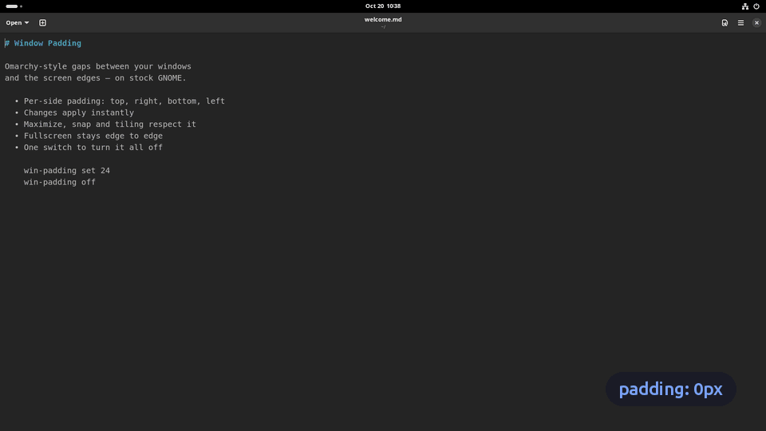
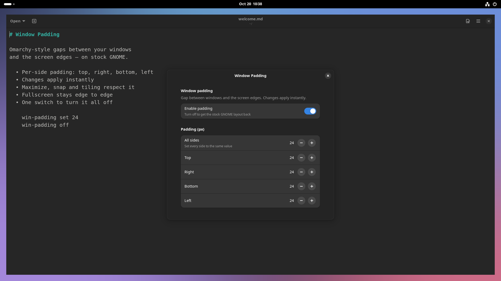

# Window Padding


A GNOME Shell extension that adds Omarchy/Hyprland-style padding (`gaps_out`)
between windows and the screen edges. Each side (top, right, bottom, left) is
configurable, changes apply instantly, and switching it off restores the stock
GNOME layout.

Tested on **GNOME Shell 46** (Ubuntu 24.04, Wayland).

_Tiếng Việt: [README.vi.md](README.vi.md)_

## How it works

GNOME computes each monitor's *work area* by subtracting the space reserved by
the top bar and dock (*struts*). Maximize, edge snapping and tiling extensions
all fill that work area. This extension adds the configured padding on top of
the existing struts on every edge, so:

| Window | Result |
|---|---|
| Maximized (or opened maximized) | Padding on all four sides |
| Snapped / tiled (Tiling Shell, Tiling Assistant) | Padding along the screen edges |
| **Fullscreen** (F11, video, games) | **Unaffected**, still edge to edge |
| Free-floating | Keeps its size, just isn't placed inside the padding |

Top padding is measured from the bottom of the top bar, not from the screen edge.



## Install

From [extensions.gnome.org](https://extensions.gnome.org) (once published), or
from source:

```bash
git clone https://github.com/pvlamkhtn/gnome-window-padding
cd gnome-window-padding
./install.sh
```

`install.sh` copies the extension to
`~/.local/share/gnome-shell/extensions/window-padding@pvlamkhtn.github.io/`,
installs the optional `win-padding` CLI to `~/.local/bin/`, and enables the
extension. On Wayland, **log out and back in once** after the first install.

## Configure

**Settings window:** open the *Extensions* app → *Window Padding* → ⚙️, or run
`win-padding prefs`. It has an on/off switch, an "All sides" shortcut, and one
field per side (0–300 px).



**CLI** (installed by `install.sh` only, not part of the extensions.gnome.org
package):

```bash
win-padding                 # show current state
win-padding set 12          # all sides 12px
win-padding set 8 16        # top/bottom 8, left/right 16
win-padding set 8 16 12 4   # top right bottom left (CSS order)
win-padding top 20          # one side (top|right|bottom|left)
win-padding off | on        # disable / enable (instant)
win-padding toggle
win-padding reset           # defaults: on, 10px everywhere
```

**GSettings** schema `org.gnome.shell.extensions.window-padding`:

| Key | Type | Default |
|---|---|---|
| `enabled` | bool | `true` |
| `padding-top`, `padding-right`, `padding-bottom`, `padding-left` | int (0–300) | `10` |

## Using it with Tiling Shell

Tiling Shell's `outer-gaps` is applied inside the work area, so it adds up
with this extension's padding (10 + 10 = 20px at the screen edges). For equal
edges on tiled and maximized windows, set Tiling Shell's outer gaps to 0 and
control the edge gap here.

## Known limitations

- **Multiple monitors:** Mutter ignores struts on an edge shared by two
  monitors, so padding only applies on the outer screen edges.
- **Rounded corners:** GTK4/libadwaita apps draw square corners when
  maximized. Omarchy's rounding comes from the Hyprland compositor; this
  extension doesn't change it.
- Desktop icons (DING) live in the work area and move inward with the padding.

## Uninstall

```bash
./uninstall.sh
```

This disables the extension, removes its saved settings, the extension files and the CLI.

## Development

```bash
./install.sh   # reinstall after editing; reloads the extension if already loaded
./pack.sh      # build release/<uuid>.shell-extension.zip for extensions.gnome.org
```

## License

[GPL-2.0-or-later](LICENSE)
