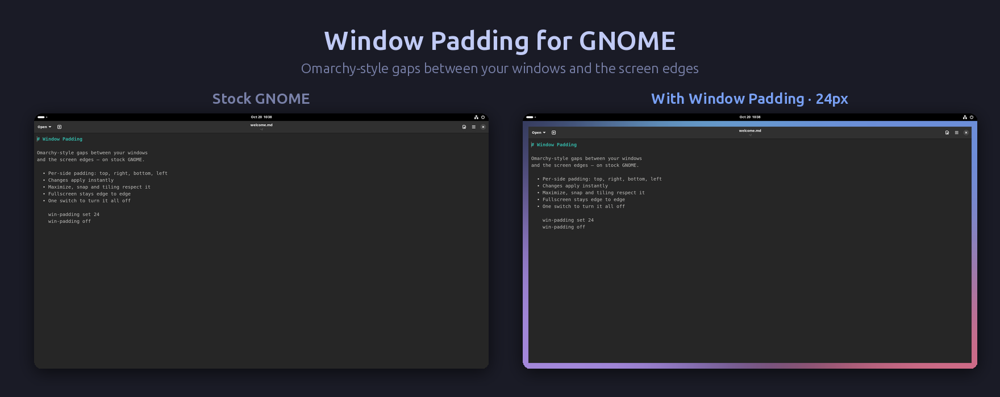

# GNOME Window Padding (Omarchy-style)



Tạo khoảng hở (padding) giữa cửa sổ và mép màn hình giống Omarchy/Hyprland
(`gaps_out`), chạy trên **Ubuntu 24.04, GNOME 46, Wayland**. Có thể chỉnh
padding từng cạnh top / right / bottom / left, hoặc tắt hẳn để quay về giao
diện GNOME gốc. Mọi thay đổi có hiệu lực **ngay lập tức**, không cần logout.

---

## 1. Hoạt động thế nào

GNOME tính ra "work area" bằng cách lấy màn hình trừ đi phần dành cho top bar
và dock (gọi là *struts*). Maximize, kéo cửa sổ vào cạnh để snap, Tiling Shell
và Tiling Assistant đều lấp đầy vùng work area này.

Extension `window-padding@pvlamkhtn.github.io` cộng thêm padding vào struts của từng
cạnh, chồng lên phần top bar/dock đang chiếm. Vì vậy:

| Trường hợp | Kết quả |
|---|---|
| App mở ở trạng thái maximize (Chrome, VS Code...) | Có padding 4 cạnh |
| Bấm maximize / double-click title bar | Có padding 4 cạnh |
| Snap nửa màn hình, tile bằng Tiling Shell | Có padding ở mép màn hình |
| **Fullscreen** (F11, video, game) | **Không bị ảnh hưởng**, vẫn tràn màn hình |
| Cửa sổ nổi kích thước tự do | Giữ nguyên kích thước, chỉ không bị đặt lấn vào padding |

Padding trên được tính **từ dưới top bar**, không tính từ mép màn hình.

Ví dụ đo thật trên màn hình 1600×900 (top bar cao 32px), padding 10px:
work area gốc `0,32 1600×868` → `10,42 1580×848`.

---

## 2. Cài đặt

```bash
git clone https://github.com/pvlamkhtn/gnome-window-padding
cd gnome-window-padding
./install.sh
```

Script sẽ:
1. Backup danh sách `enabled-extensions` vào `~/.config/window-padding-backup/`.
2. Copy extension vào `~/.local/share/gnome-shell/extensions/window-padding@pvlamkhtn.github.io/`
   và compile schema.
3. Cài CLI `win-padding` vào `~/.local/bin/`.
4. Bật extension (chỉ **thêm** vào danh sách, không đụng extension khác).

**Lần cài đầu tiên phải logout rồi login lại 1 lần.** Trên Wayland, GNOME Shell
chỉ quét extension mới lúc đăng nhập. Sau khi bạn sửa code và chạy lại
`install.sh`, extension sẽ tự reload, không cần logout.

---

## 3. Chỉnh padding

### Cách 1: giao diện Settings

```bash
win-padding prefs
```

Hoặc mở app **Extensions** → *Window Padding* → ⚙️. Trong đó có:
- Công tắc **Enable padding**.
- **All sides**: đặt cùng một giá trị cho cả 4 cạnh.
- **Top / Right / Bottom / Left**: chỉnh từng cạnh (0–300px).

### Cách 2: CLI `win-padding`

```bash
win-padding                 # xem trạng thái hiện tại
win-padding set 12          # 4 cạnh = 12px
win-padding set 8 16        # top+bottom = 8, left+right = 16
win-padding set 8 16 12 4   # top right bottom left (thứ tự như CSS)
win-padding top 20          # chỉ đổi 1 cạnh (top|right|bottom|left)
win-padding off             # tắt padding → về giao diện GNOME gốc
win-padding on              # bật lại
win-padding toggle          # đảo trạng thái (gán vào phím tắt cũng được)
win-padding reset           # về mặc định: bật, 10px mỗi cạnh
```

### Cách 3: gsettings trực tiếp

```bash
gsettings --schemadir ~/.local/share/gnome-shell/extensions/window-padding@pvlamkhtn.github.io/schemas \
  set org.gnome.shell.extensions.window-padding padding-left 24
```

| Key | Kiểu | Mặc định |
|---|---|---|
| `enabled` | bool | `true` |
| `padding-top` / `padding-right` / `padding-bottom` / `padding-left` | int (0–300) | `10` |

---

## 4. Dùng chung với Tiling Shell

Tiling Shell có sẵn `outer-gaps` (khoảng hở mép màn hình) và `inner-gaps`
(khoảng hở giữa các cửa sổ tile). Vì Tiling Shell tile trong work area, padding
của extension này sẽ **cộng dồn** với `outer-gaps`. Ví dụ padding 10 + outer-gaps
10 thì mép màn hình hở 20px.

Muốn mép màn hình hở đều nhau dù cửa sổ đang tile hay maximize, hãy để
outer-gaps của Tiling Shell về 0 và chỉ chỉnh padding ở đây:

```bash
gsettings --schemadir ~/.local/share/gnome-shell/extensions/tilingshell@ferrarodomenico.com/schemas \
  set org.gnome.shell.extensions.tilingshell outer-gaps 0
```

---

## 5. Tắt / gỡ cài đặt

- **Tắt tạm** (giữ cài đặt): `win-padding off`, hoặc tắt extension trong app
  Extensions. Cửa sổ trở về như cũ ngay lập tức.
- **Gỡ hẳn**:

  ```bash
  ./uninstall.sh
  ```

  Script tắt extension, xoá setting đã lưu, xoá extension và CLI. Thư mục backup
  `~/.config/window-padding-backup/` được giữ lại.

---

## 6. Giới hạn đã biết

- **Nhiều màn hình:** Mutter bỏ qua struts nằm ở cạnh tiếp giáp giữa hai màn
  hình. Vì vậy padding chỉ có ở các cạnh ngoài cùng của toàn bộ màn hình, cạnh
  tiếp giáp giữa hai màn hình sẽ không có padding.
- **Bo góc:** khi maximize, app GTK4/libadwaita tự vẽ góc vuông (hành vi của
  GNOME). Omarchy bo góc được vì Hyprland vẽ bo góc ở cấp compositor, còn
  extension này không thay đổi điều đó.
- Desktop icons (DING) cũng nằm trong work area, nên lùi vào theo padding.
- Hỗ trợ GNOME Shell 46–51 (khai báo trong `metadata.json`); đã test thực tế trên GNOME Shell 46.

---

## 7. Cấu trúc

```
my-gnome-window-padding/
├── extension/
│   ├── metadata.json
│   ├── extension.js        # cộng padding vào struts, nghe thay đổi setting
│   ├── prefs.js            # giao diện Settings (libadwaita)
│   └── schemas/org.gnome.shell.extensions.window-padding.gschema.xml
├── bin/win-padding         # CLI
├── install.sh
├── uninstall.sh
├── pack.sh                 # đóng gói zip để upload lên extensions.gnome.org
├── LICENSE                 # GPL-2.0-or-later
└── README.md               # bản tiếng Anh
```

Đóng gói để publish: `./pack.sh` → `release/window-padding@pvlamkhtn.github.io.shell-extension.zip`
(chỉ gồm file extension cần để chạy, không kèm script/CLI).
